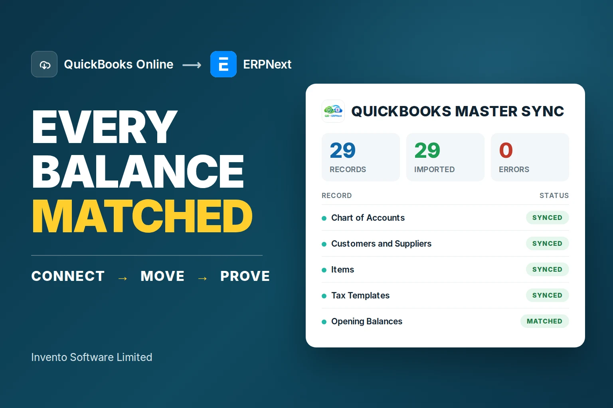
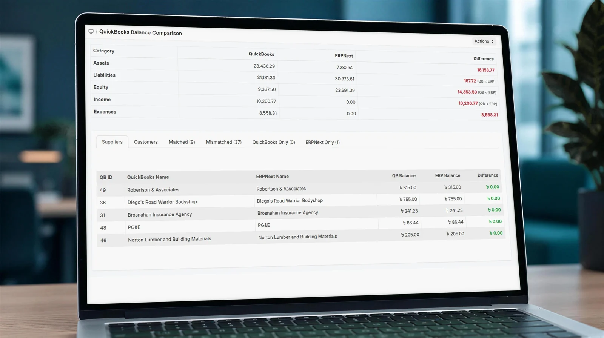
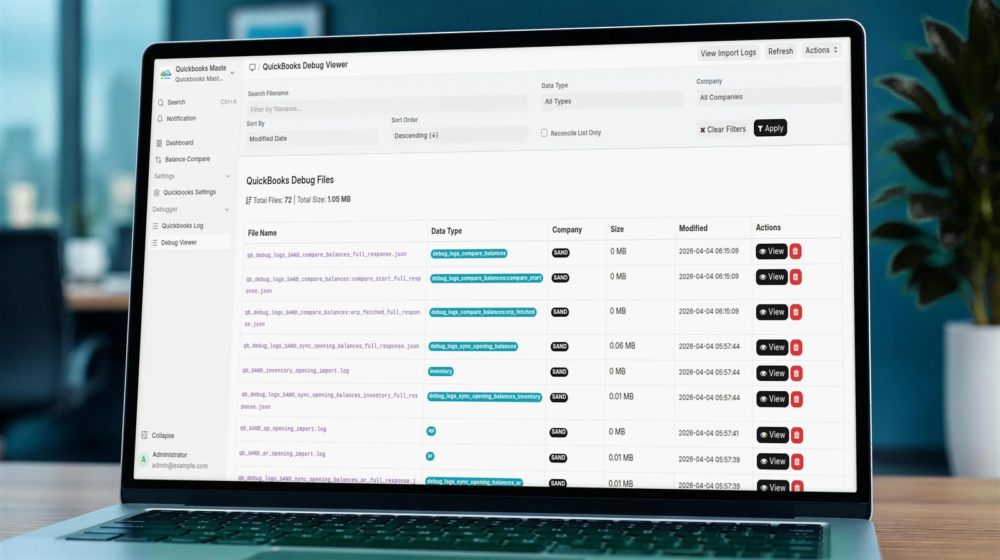

<p align="center">
  <a href="https://invento.com.bd">
    
  </a>
</p>

<h1 align="center">QuickBooks Master Sync</h1>

<p align="center">
  Move QuickBooks Online master data and opening balances into ERPNext, then compare both systems before go-live.
</p>

<p align="center">
  
  
  
  
</p>

<p align="center">
  <strong><a href="https://cloud.frappe.io/marketplace/apps/quickbooks_master_sync">Install from Marketplace</a></strong>
  &nbsp;&middot;&nbsp;
  <strong><a href="https://invento.com.bd/quickbooks-to-erpnext-migration/">See how the migration works</a></strong>
  &nbsp;&middot;&nbsp;
  <strong><a href="https://invento-software-limited.github.io/quickbooks_master_sync/">Documentation</a></strong>
</p>

<p align="center">
  <a href="https://invento.com.bd/quickbooks-to-erpnext-migration/">
    
  </a>
</p>

## Connect. Move. Prove.

| 1. Connect | 2. Move | 3. Prove |
| --- | --- | --- |
| Sign in to QuickBooks Online through OAuth2. Each ERPNext company keeps its own credentials. | Bring the accounting structure and master records into the ERPNext company you choose. | Compare balances side by side and resolve differences before teams start working in ERPNext. |

The app runs inside ERPNext and keeps a trace of the QuickBooks responses received during each migration. It is designed for **QuickBooks Online**; QuickBooks Desktop company files require a different migration route.

## What moves into ERPNext

| QuickBooks Online | ERPNext |
| --- | --- |
| Chart of Accounts | Chart of Accounts, including account type, root type and hierarchy |
| Customers | Customers, contacts, addresses and tax details |
| Vendors | Suppliers, contacts, addresses and tax details |
| Items and services | Items |
| Tax codes and rates | Sales Tax Templates |
| Payment terms | Payment Terms Templates |
| Payment methods | Modes of Payment |
| Opening balances | Opening balances synced at the end of the run |

## See the result before go-live

### Balance comparison

Customer and supplier balances are compared between QuickBooks Online and ERPNext. Results are grouped into **Matched**, **Mismatched**, **QuickBooks Only** and **ERPNext Only**, so the finance team can investigate the exact difference.

<p align="center">
  
</p>

<p align="center"><em>Shown with sandbox data. The free edition includes customer and supplier reconciliation; account-level comparison is included in the full edition.</em></p>

### Traceable migration records

The debug viewer stores QuickBooks API responses by company, data type and time. Records can be inspected from ERPNext when a migration result needs to be traced back to its source.

<p align="center">
  
</p>

<p align="center"><em>QuickBooks Debug Viewer shown with sandbox data.</em></p>

## Key capabilities

| Capability | What it does |
| --- | --- |
| Secure OAuth2 connection | Connects ERPNext to QuickBooks Online without storing a QuickBooks password |
| Multi-company setup | Maintains separate QuickBooks credentials and sync settings for each ERPNext company |
| Live sync progress | Shows each migration step as completed, running or failed through Frappe realtime events |
| Opening balance sync | Runs after master records so ERPNext begins from the intended financial position |
| Reconciliation | Compares customer and supplier balances across both systems |
| Debug viewer | Makes stored API responses searchable and reviewable from ERPNext |
| Migration logs | Records sync activity for investigation and audit support |

## Free and full editions

The Marketplace app covers the core move into ERPNext. Invento provides the full edition for teams that also need historical transactions and account-level reconciliation.

| Feature | Free | Full |
| --- | :---: | :---: |
| Master data | ✓ | ✓ |
| Opening balances | ✓ | ✓ |
| Customer and supplier balance comparison | ✓ | ✓ |
| Account-level balance comparison | — | ✓ |
| Sales invoices, purchase invoices and payments | — | ✓ |
| Journal entries | — | ✓ |

For the full migration edition, contact [munim@invento.com.bd](mailto:munim@invento.com.bd).

## Installation

### ERPNext and Frappe v16

```bash
cd $PATH_TO_YOUR_BENCH
bench get-app https://github.com/invento-software-limited/quickbooks_master_sync.git --branch version-16
bench --site your-site.example install-app quickbooks_master_sync
```

### ERPNext and Frappe v15

```bash
cd $PATH_TO_YOUR_BENCH
bench get-app https://github.com/invento-software-limited/quickbooks_master_sync.git --branch version-15
bench --site your-site.example install-app quickbooks_master_sync
```

### Requirements

- ERPNext and Frappe v15 or v16
- A QuickBooks Online company
- A Client ID and Client Secret from an Intuit developer app

## Configuration

1. Open **QuickBooks Settings** in ERPNext.
2. Enter the Client ID and Client Secret from your Intuit developer app.
3. Select **Connect QuickBooks** and approve access in QuickBooks Online.
4. Choose the ERPNext company that will receive the records.
5. Run **Actions → Sync QuickBooks** and follow the live progress.
6. Review the balance comparison before go-live.

## Compatibility

| App branch | Frappe and ERPNext |
| --- | --- |
| `version-16` | v16 |
| `version-15` | v15 |
| `develop` | Active development |

## Resources

- [Frappe Cloud Marketplace listing](https://cloud.frappe.io/marketplace/apps/quickbooks_master_sync)
- [QuickBooks to ERPNext migration guide](https://invento.com.bd/quickbooks-to-erpnext-migration/)
- [Product documentation](https://invento-software-limited.github.io/quickbooks_master_sync/)
- [Report an issue](https://github.com/invento-software-limited/quickbooks_master_sync/issues)

<details>
<summary><strong>Development setup</strong></summary>

```bash
cd apps/quickbooks_master_sync
pre-commit install
```

The repository uses Ruff, ESLint, Prettier, PyUpgrade and Semgrep through its pre-commit and GitHub Actions configuration.

</details>

## License

QuickBooks Master Sync is available under the [MIT License](./license.txt).

<p align="center">
  Built and maintained by <a href="https://invento.com.bd"><strong>Invento Software Limited</strong></a>.
</p>
