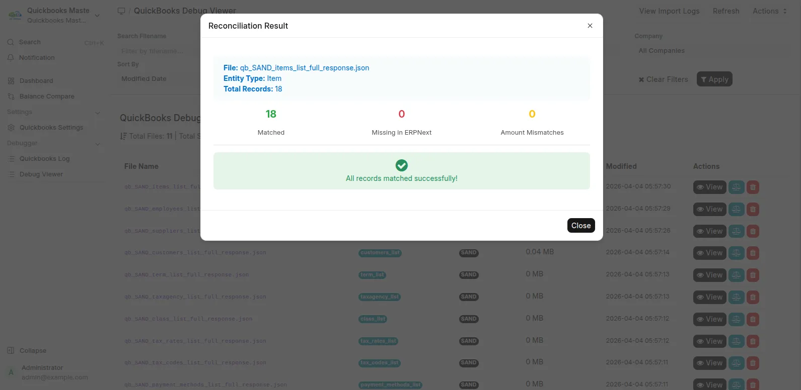

# QuickBooks Master Sync for ERPNext

Move QuickBooks Online master records and opening balances into ERPNext, then check customer and supplier balances. The free Marketplace app supports release branches for ERPNext v15 and v16.

[Install from Frappe Cloud Marketplace](https://cloud.frappe.io/marketplace/apps/quickbooks_master_sync) · [User guide](user_guide.md) · [Discuss your migration](https://invento.com.bd/free-consultation/?utm_source=github_docs&utm_medium=referral&utm_campaign=quickbooks_master_sync&utm_content=overview_enquiry)

## Who it helps

Finance teams and ERPNext implementers planning a move from QuickBooks Online. The app runs inside ERPNext, imports through Intuit's API, and provides comparison and investigation tools for the migration review.

## What moves

| QuickBooks Online | ERPNext destination |
| --- | --- |
| Chart of accounts | Accounts, including hierarchy and account classification |
| Customers | Customers and related contact/address records |
| Vendors | Suppliers and related contact/address records |
| Items and services | Items |
| Tax codes and rates | Sales Tax Templates |
| Payment terms | Payment Terms Templates |
| Payment methods | Modes of Payment |
| Opening balances | Opening entries; review the resulting ledger and party balances |

## How a run works

Connect through OAuth 2.0, review the company configuration, start a background sync, then inspect the logs and customer/supplier comparisons. Company setup can import related records as part of connection or sync.

The progress display updates live during a run. Scheduled synchronization and ERPNext-to-QuickBooks writes are not enabled by the public app. It is not a QuickBooks Desktop file importer.

## Free and full editions

| Capability | Free Marketplace app | Full migration engagement |
| --- | --- | --- |
| Master records and opening balances | Included | Scope agreed with Invento |
| Customer and supplier balance comparison | Included | Scope agreed with Invento |
| Detailed account comparison tabs | Restricted in the public app | Contact Invento |
| Historical invoices, bills, payments and journals | Not included | Confirm coverage with Invento before purchase |

The public app includes customer and supplier comparison. Detailed account tabs are premium-gated. Full transaction migration must be scoped separately with Invento; confirm coverage and pricing before purchase. A feature mentioned in an older roadmap is not a promise of current availability.

## Read the evidence correctly

*QuickBooks sandbox example. Supplier rows shown match; account summary differences are still visible. These are product examples, not client results or a guarantee that all balances will match.*

*This separate screen compares item records, not customer balances or a complete financial migration.*

The [ACE Advisory case study](https://invento.com.bd/work/ace-advisory-erpnext-vat-software-bangladesh/) describes an Invento implementation for more than 100 client companies. The scope of that engagement exceeds what is promised by the free app.

## Requirements and boundaries

- Frappe and ERPNext v15 or v16, with the matching app branch.
- A QuickBooks Online company and an Intuit developer app with Accounting API access.
- Administrator/implementer access to install and configure the app, working background jobs and a test backup.
- A reviewed company setup and cutover plan. Default opening-balance runs use the current date and can submit accounting documents.
- Review errors even after a run completes. A rerun is not a universal rollback; current code has a separate destructive company-data utility, which is not a recovery workflow.

## Start here

[Install the free app](https://cloud.frappe.io/marketplace/apps/quickbooks_master_sync), follow the [setup guide](user_guide.md), or [discuss a migration with Invento](https://invento.com.bd/free-consultation/?utm_source=github_docs&utm_medium=referral&utm_campaign=quickbooks_master_sync&utm_content=overview_footer). For a technical problem, use [GitHub Issues](https://github.com/invento-software-limited/quickbooks_master_sync/issues) with redacted evidence.

MIT licensed. Maintained by [Invento Software Limited](https://invento.com.bd/).
